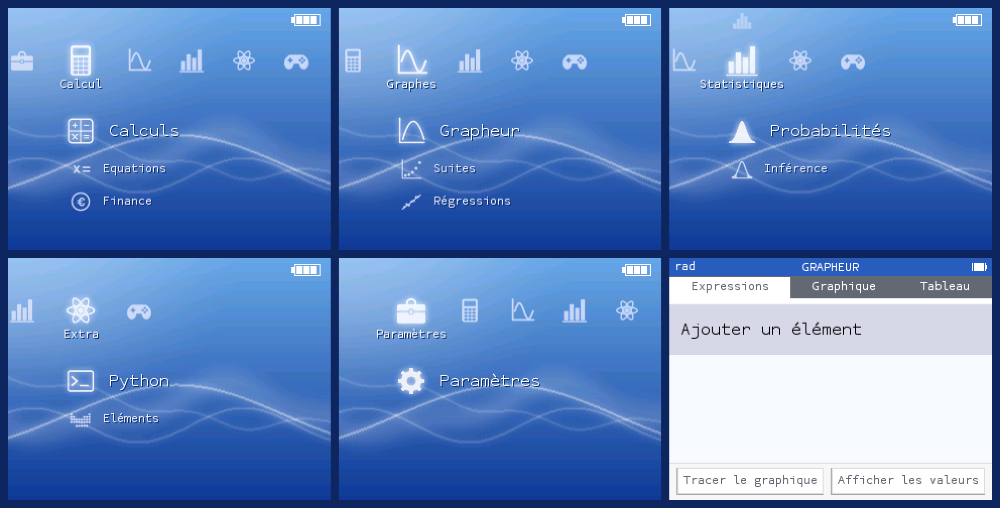
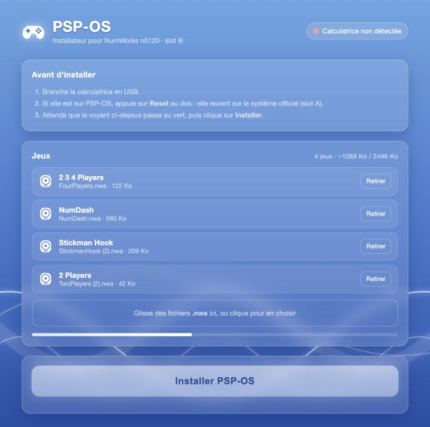

# PSP-OS : le menu de la PSP sur NumWorks

**PSP-OS remplace l'écran d'accueil de la calculatrice NumWorks (n0110, n0115 ou n0120) par un
menu inspiré du XMB de la PSP** : les catégories à l'horizontale, les applis à
la verticale, le fond bleu avec ses lignes de lumière qui ondulent, et une
catégorie **Jeux** pour tes applis `.nwa`.



<p align="center"></p>

## Ce que fait PSP-OS

- **Menu façon XMB** : 6 catégories (Paramètres, Calcul, Graphes,
  Statistiques, Extra, Jeux) ; ◀ ▶ changent de catégorie, ▲ ▼ d'appli, OK ou
  EXE lancent l'appli. L'appli précédente remonte au-dessus de la ligne des
  catégories, comme sur la console.
- **Animations** : fond animé (quatre lignes de lumière qui ondulent et
  dérivent), glissement des catégories, défilement des applis, halo qui
  « respire » autour de la sélection, fondu à l'ouverture du menu.
- **19 icônes dessinées pour le projet**, blanches avec un halo lumineux
  (générées par `apps/home/psp/gen_icons.py`, dans le patch).
- **Barre de titre bleue** dans toutes les applis, au lieu du jaune NumWorks.
- **Catégorie Jeux** : tes applis `.nwa` y apparaissent sous forme de disques
  UMD.
- **Installateurs en un clic pour Mac et pour Windows** : une page web
  locale qui détecte la calculatrice, gère tes jeux (glisser-déposer) et
  installe tout avec un bouton. Sur Windows, un simple `.exe` : rien à
  installer, ni Python ni pilote.



## Installation

### 1. Obtenir PSP-OS

Depuis juillet 2021, le code d'Epsilon (le logiciel de la NumWorks) n'est plus
sous licence libre. PSP-OS ne publie donc **aucun code ni aucun firmware de
NumWorks** : seulement un **patch** (`patches/psp-os-epsilon.patch`) et son
propre code. Le firmware se compile à partir des sources officielles de
NumWorks, dans ton compte GitHub ou sur ton Mac.

**Sans rien compiler (Mac ou Windows)**

1. En haut de cette page : **Use this template** > **Create a new repository**,
   coche **Private** (obligatoire : la compilation refuse de tourner dans un
   dépôt public, pour que le firmware ne soit pas téléchargeable par tous).
2. Facultatif : ajoute tes jeux `.nwa` dans le dossier `games/` de ta copie
   privée (*Add file* > *Upload files*). Ils seront préparés et inclus dans
   l'installateur.
3. Dans ta copie : onglet **Actions** > **Build PSP-OS** > **Run workflow**.
4. Environ 30 minutes plus tard (un firmware par modèle), en bas de la page de la compilation,
   télécharge **PSP-OS-Mac** ou **PSP-OS-Windows** et décompresse-le
   (deux fois pour la version Mac : GitHub met le zip dans un zip).

**En compilant sur ton Mac**

```bash
brew install make dfu-util libusb
brew install --cask gcc-arm-embedded
git clone https://github.com/derim00/psp-os.git && cd psp-os
./scripts/build-firmware.sh
```

Le script télécharge Epsilon au commit indiqué dans `EPSILON_COMMIT`
(Epsilon 26.1, la dernière version publiée par NumWorks), applique le patch,
compile, prépare les jeux de `games/` et remplit le dossier `installer/`.

### 2. Installer sur la calculatrice

**Sur Mac**

1. Une seule fois : `brew install libusb dfu-util` (et
   `brew install --cask gcc-arm-embedded` pour ajouter d'autres jeux).
2. Double-clique sur **`Installer PSP-OS.command`** (la première fois :
   clic droit > **Ouvrir**). La page de l'installateur s'ouvre
   (http://127.0.0.1:8765).

**Sur Windows** (rien à installer : ni Python, ni pilote)

1. Décompresse **PSP-OS-Windows** (clic droit > *Extraire tout*) : ne
   lance pas l'installateur depuis l'intérieur du zip.
2. Dans le dossier `PSP-OS`, double-clique sur **`Installer PSP-OS.exe`**
   (si SmartScreen s'affiche : *Informations complémentaires* > *Exécuter
   quand même*). Une fenêtre noire s'ouvre avec la page de l'installateur dans
   ton navigateur : laisse-la ouverte, et ferme-la à la fin pour quitter.
   Comme pour NumSocial, l'`.exe` contient Python et libusb, et la
   calculatrice se déclare comme périphérique WinUSB : Windows la reconnaît
   sans pilote.

**Ensuite, sur les deux**

3. Branche la calculatrice en USB et appuie sur **Reset** au dos : elle
   redémarre sur le système officiel.
4. Quand le voyant passe au vert, glisse tes jeux `.nwa` dans la page si tu
   veux, puis clique sur **Installer PSP-OS**.

L'installateur vérifie que le **slot B** est libre avant d'écrire : le système
officiel (slot A) n'est jamais modifié. Il prépare les jeux pour leur place
dans le slot B (comme le fait le site de NumWorks), les copie, les relit pour
les vérifier, puis installe PSP-OS et le démarre.

## À savoir

- **Calculatrice** : NumWorks **n0110**, **n0115** ou **n0120**, avec le logiciel officiel
  **26.4.0** dans le slot A. PSP-OS est compilé à partir d'Epsilon 26.1 (la
  dernière version publiée) avec le numéro de version 26.4.0.
- **Trois modèles** : la compilation produit un firmware par modèle
  (n0110, n0115, n0120) et l'installateur choisit tout seul celui de la
  calculatrice branchée. Mets d'abord ta calculatrice à jour sur
  numworks.com : le système doit avoir la même version que le logiciel
  officiel du slot A.
- **Jeux trop gros** : un jeu qui ne tient pas dans le slot B (NumPlay,
  par exemple) est ignoré avec un message, au lieu de faire échouer la
  compilation. Retire-le du dossier `games/`.
- **Après un Reset**, la calculatrice revient sur le système officiel :
  PSP-OS reste dans le slot B, il suffit de cliquer à nouveau sur
  **Installer PSP-OS** pour le relancer.
- **Touches Home et On/Off** : sur un logiciel non officiel, le système de la
  calculatrice gère lui-même ces deux touches. PSP-OS efface au démarrage le
  point de retour laissé par le système officiel pour que Home ramène au menu
  PSP ; si la calculatrice revient quand même sur le slot A, utilise
  **Retour** (↩) pour revenir au menu depuis une appli.
- **Jeux sur Windows** : les jeux déjà présents dans `games/` lors de la
  compilation sont prêts ; pour en ajouter d'autres directement depuis
  Windows, il faut la chaîne ARM
  ([Arm GNU Toolchain](https://developer.arm.com/downloads/-/arm-gnu-toolchain-downloads),
  version *arm-none-eabi*).
- **Jeux** : seulement des applis `.nwa` dont tu as le droit de te servir, et
  uniquement dans ta copie privée : jamais dans ce dépôt public.

## Comment c'est fait

| Fichier | Rôle |
| --- | --- |
| `patches/psp-os-epsilon.patch` | le menu XMB (`apps/home`), les icônes, les animations (`escher`), la barre bleue |
| `scripts/build-firmware.sh` | télécharge Epsilon, applique le patch, compile, prépare l'installateur |
| `installer/server.py` | serveur local (127.0.0.1 uniquement) de l'installateur, Mac et Windows |
| `installer/dfu_launch.py` | lance l'outil DFU de NumWorks avec libusb (Homebrew ou `libusb-package`) et les correctifs Windows de NumSocial |
| `scripts/build-windows-installer.py` | fait `Installer PSP-OS.exe` avec PyInstaller (sur Windows, dans le workflow) et le teste |
| `installer/index.html` | la page de l'installateur |
| `installer/link_games.py` | place chaque jeu `.nwa` à son adresse dans le slot B, comme le site de NumWorks |
| `installer/Installer PSP-OS.command` | lanceur en double-clic pour Mac |
| `.github/workflows/build.yml` | compilation dans ta copie privée, avec les deux installateurs |

## Licence

Le code de PSP-OS est sous licence **CC BY-NC-SA 4.0** (voir `LICENSE`).
Epsilon reste la propriété de NumWorks et n'est pas inclus dans ce dépôt.
PSP-OS est un projet de fan, sans lien avec Sony Interactive Entertainment ni
avec NumWorks ; PlayStation, PSP et XMB sont des marques de Sony Interactive
Entertainment.
